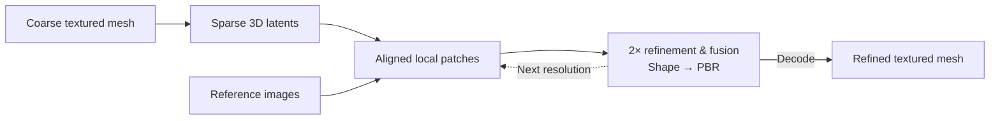

<div align="center">

# PLSR: Progressive and Localized Super-Resolution<br>of 3D Objects via Localized Latent Voxel Diffusion

<!-- Placeholder arXiv URL. -->
[](https://arxiv.org/abs/0000.00000)

</div>

PLSR refines a coarse 3D object using one or more reference images, adding detail
to both its geometry and PBR materials. Built on TRELLIS.2, it operates on local
patches in sparse 3D latent space and progressively increases their resolution.

<!-- Replace this placeholder with the project teaser. -->
<table>
  <tr>
    <td align="center" width="960">
      <br><br>
      <strong>Teaser placeholder</strong>
      <br><br><br>
    </td>
  </tr>
</table>

## Method overview

We pair local 3D patches with corresponding image crops, refine geometry and
materials, and fuse overlapping patch predictions during denoising. Repeating
the same 2× refinement process produces progressively finer 3D detail.



## Code

Install with the [Linux/WSL guide](docs/INSTALL.md) or
[Windows guide](docs/INSTALL_WINDOWS.md), then run from the repository root:

```bash
python -m plsr infer --image /path/to/reference.png --output-dir /path/to/result
```

Add `--low-memory` to use smaller batches and camera CPU offload while keeping
the requested resolutions and quality settings. Explicit batch/offload options
override this preset. See [usage](docs/INFERENCE_USAGE.md) for mesh and camera
inputs, export controls and continuing an interrupted run. The console shows
per-part decoding/baking progress before the final GLB is written.

For a new machine, follow the [validation steps](docs/VALIDATION.md).

## Acknowledgments

Our work builds on [TRELLIS.2](https://github.com/microsoft/TRELLIS.2) and O-Voxel.
