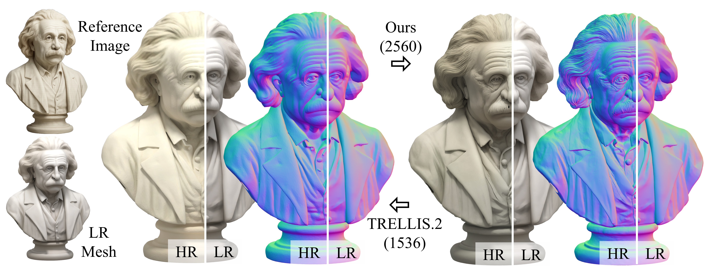
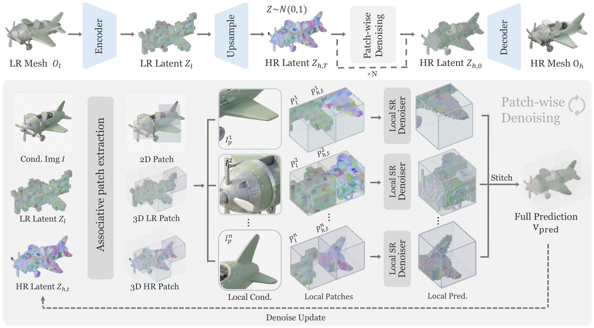

<div align="center">

# PLSR: Progressive and Localized Super-Resolution<br>of 3D Objects via Localized Latent Voxel Diffusion

Yuxin Liu, Minshan Xie, Jiawen Liang, Runsong Zhu, Chi-Wing Fu, Tien-Tsin Wong

[](https://arxiv.org/html/2609.06436v1)

</div>

PLSR refines a coarse 3D object using one or more reference images, adding detail
to both its geometry and PBR materials. Built on TRELLIS.2, it operates on local
patches in sparse 3D latent space and progressively increases their resolution.

By decomposing a global super-resolution task into local refinement steps, PLSR
reduces memory requirements while preserving consistency across neighboring
patches. The same model can be applied repeatedly, doubling the resolution along
each axis in every round to produce progressively finer 3D detail.



*Figure 1 from the [paper](https://arxiv.org/html/2609.06436v1): PLSR enhances fine details beyond the output resolution of existing 3D generators. Zoom in to inspect the geometry.*

## Method overview



*Figure 2 from the [paper](https://arxiv.org/html/2609.06436v1): the progressive and localized super-resolution pipeline.*

1. **Encode and initialize.** Encode the coarse mesh into sparse 3D latents,
   upsample the voxel support, and initialize the high-resolution latents with noise.
2. **Extract aligned conditions.** Pair each high-resolution latent patch with
   its low-resolution counterpart and a corresponding crop from the reference image.
3. **Refine and aggregate.** Predict local updates with the localized SR model
   and blend overlapping patch predictions at every denoising step to maintain
   global coherence.
4. **Decode or repeat.** Decode the refined latents into a textured mesh, or use
   them as the low-resolution condition for another 2× super-resolution round.

## Code

**To be released soon.**

## Citation

If you use PLSR in your research, please cite:

```bibtex
@misc{liu2026plsr,
  title         = {{PLSR}: Progressive and Localized Super-Resolution of {3D} Objects via Localized Latent Voxel Diffusion},
  author        = {Liu, Yuxin and Xie, Minshan and Liang, Jiawen and Zhu, Runsong and Fu, Chi-Wing and Wong, Tien-Tsin},
  year          = {2026},
  eprint        = {2609.06436},
  archivePrefix = {arXiv},
  primaryClass  = {cs.CV},
  url           = {https://arxiv.org/abs/2609.06436}
}
```

## Acknowledgments

Our work builds on [TRELLIS.2](https://github.com/microsoft/TRELLIS.2) and O-Voxel.
